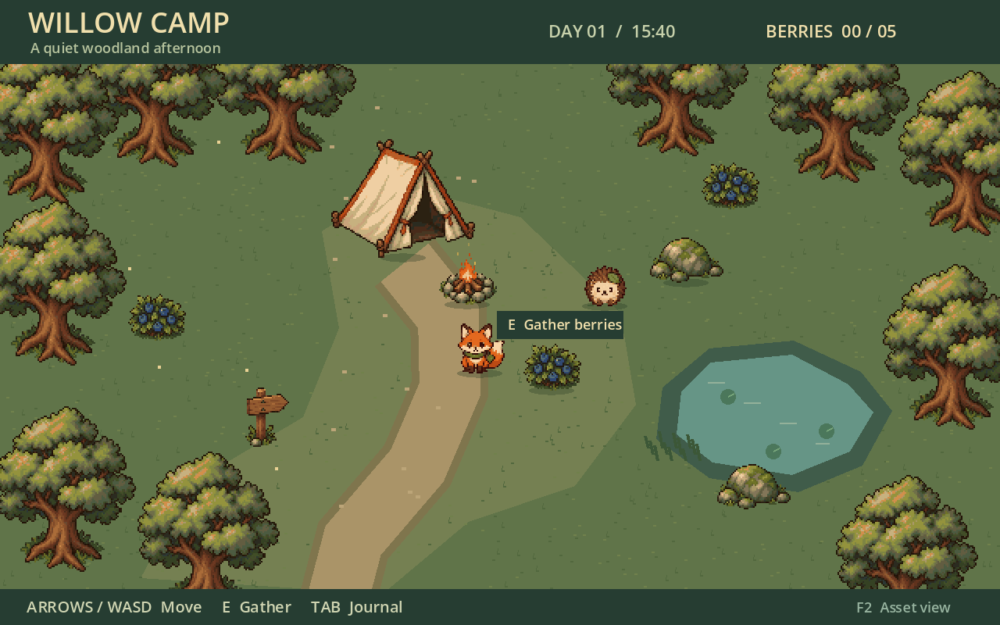
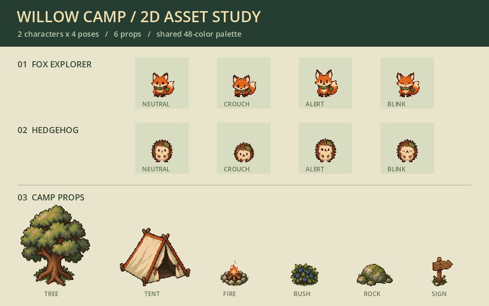
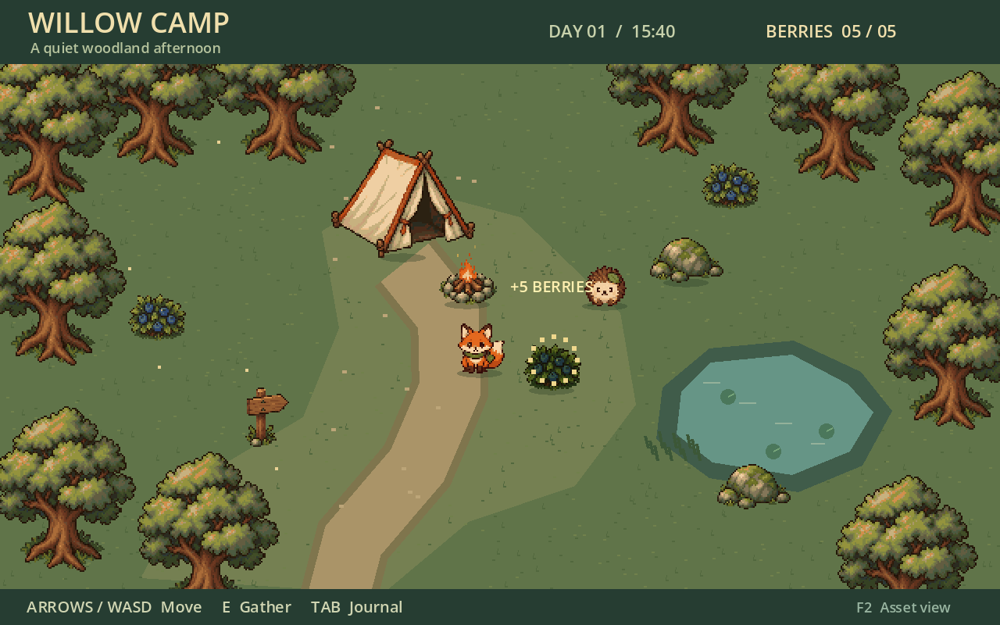
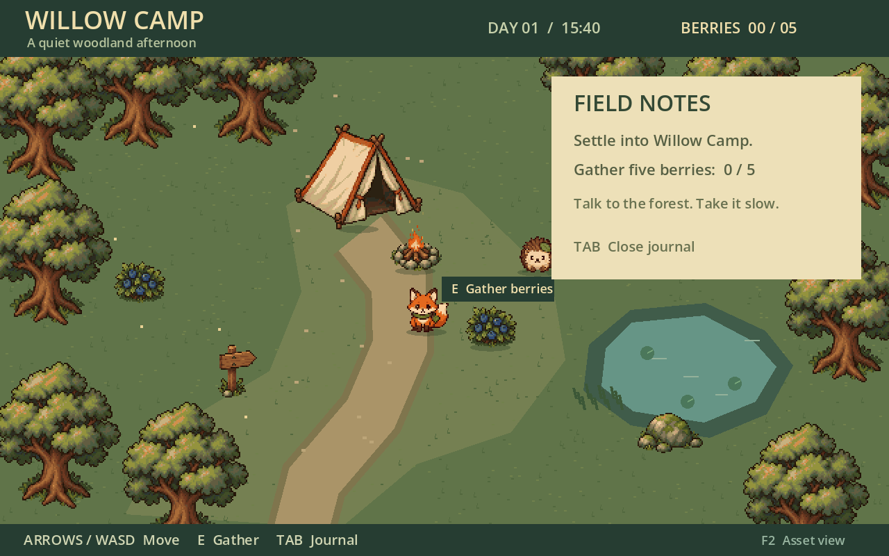

# Pixel Game Workflow · 像素游戏工作流

面向 Codex 的像素游戏制作技能：内置生图制作候选素材板，脚本切分与对齐，Pixelorama 保存可编辑素材，Godot 接入并验证玩法和画面。

适合像素游戏原型、角色动画、地块与道具制作，以及已有 Godot 工程的素材迭代。可以只执行其中一段。附带一个可独立运行的农场机制样板。



上图为 2026-10-16 按当前技能重新制作的 Willow Camp：内置生图 → 确定性整理与限色 → Pixelorama 可编辑工程 → Godot 实际运行与输入检查。



两个角色各四帧、六件道具，共用 48 色。[本次示例工程、原图、提示词与 pxo](examples/woodland-camp/README.md) 均随仓库提供。农场初始化器仍生成原农场样板，新展示对应独立示例。

## 选择 Demo

| 你的目标 | 工程入口 | 操作与范围 |
|---|---|---|
| 试玩上图的林地营地 | [Willow Camp](examples/woodland-camp/project.godot) | WASD／方向键移动，E 采集，Tab 日志，F2 素材展示；一次采集小样 |
| 从空目录开始做种田原型 | [农场初始化说明](#不依赖-mcp-的快速开始) | 初始化后打开输出目录的 project.godot；空格播种、浇水、收获 |

下载整个仓库 ZIP 并解压，或克隆后，在 Godot 项目管理器中导入对应 `project.godot`，再按 F5。独立试玩不需要 Python、Pixelorama 或 MCP；运行素材脚本时才需要 Python 依赖。当前只提供工程源文件，未提供可双击的游戏发行版。

<details>
<summary>查看采集反馈与日志面板</summary>





这两张图与首页主图均为 2026-10-16 的实际运行记录。2026-10-17 发布复核已检查图片、最终资源和文档对应关系；本轮未重做图像或重新执行 MCP 输入试玩。

</details>

## 第三方 MCP 致谢

感谢以下独立开源项目。本技能负责编排工作流，编辑器操作能力来自它们：

| 原项目与仓库 | 职责 |
|---|---|
| [Pixelorama-MCP · abidoo22/Pixelorama-MCP](https://github.com/abidoo22/Pixelorama-MCP) | 导入帧、保存 pxo、导出 PNG 与重开验证 |
| [Godot AI · hi-godot/godot-ai](https://github.com/hi-godot/godot-ai) | Godot 运行、输入注入、状态、截图和日志 |

两者由各自维护者开发、独立安装；本仓库不包含它们的代码或插件。详见 [来源和授权](docs/provenance.md)。

## 安装

下载或克隆本仓库，将整个仓库目录命名为 `pixel-game-workflow`，放入你的 Codex 技能目录。例如 Windows 的 `%USERPROFILE%/.codex/skills/pixel-game-workflow/`。安装后 `SKILL.md` 应直接位于该目录下；不要只复制这一份 Markdown，脚本、参考资料和样板都需要保留。已有同名技能时先备份，避免覆盖自己的修改。

本仓库本身就是技能根目录，不需要额外一层 `skills/`。在 Codex 中确认技能已被发现后，可以这样调用：

```text
使用 $pixel-game-workflow，在我指定的空目录制作一个俯视角种田原型。
先确认美术规格和代表场景，再做角色、地形、播种与收获，并分别报告玩法和视觉验收结果。
```

```text
使用 $pixel-game-workflow，为现有 Godot 工程制作两个简单角色的四帧待机动画。
保留原主场景，保存素材板、切分契约、PNG 和可编辑 pxo，在独立预览场景中验证。
```

## 依赖

| 操作 | 所需依赖 |
|---|---|
| 只初始化农场样板 | Python 3.10+，标准库即可 |
| 切分图集、素材静态检查 | Python 3.10+、Pillow；见 `requirements.txt` |
| 重建规则化样板素材数据 | Node.js；生成器无第三方包 |
| 生图 | 可调用内置 `image_gen` 的 Codex 环境及 imagegen 技能；本仓库不提供生图服务 |
| 可编辑素材制作 | Pixelorama、Pixelorama-MCP |
| 独立试玩 | 推荐使用历史实测 Godot 4.7.2；Willow Camp 工程声明 4.7，其他版本未由本仓库验证 |
| MCP 运行验收 | Godot AI；历史实测版本为 4.3.0 |

Python 可用性先用 `python --version` 确认；Windows 若只找到不可运行的商店占位程序，请使用实际安装的 Python 路径。建议使用独立虚拟环境：

```text
python -m venv .venv
```

下文中的 `python` 指虚拟环境解释器：Windows 为 `.venv/Scripts/python.exe`，macOS/Linux 为 `.venv/bin/python`。用该解释器执行：

```text
python -m pip install -r requirements.txt
```

MCP 的获取、配置和连接检查见 [安装与连接](docs/setup.md)。缺少 MCP 时可以初始化、运行静态工具和手动试玩，但不能报告 MCP 验收通过。

## 不依赖 MCP 的快速开始

在仓库根目录运行，输出目录应不存在或为空：

```text
python scripts/bootstrap.py --output ../farm-demo
python scripts/audit_assets.py --root ../farm-demo --contract ../farm-demo/assets/qa-contract.json --out ../farm-demo/reports/asset-check-001
```

在 Godot 中导入生成的 `project.godot`，按 F5。WASD/方向键移动，靠近农田按空格播种、浇水、收获；完整操作见生成工程的 `DEMO.md`。

可选参数 `--godot` 指向本机 Godot 可执行文件，`--godot-ai-addon` 指向已安装且确认可用的插件目录。初始化器仅复制该插件，不下载它。Windows 可使用生成的 `run-demo.cmd`；其他系统直接用 Godot 打开工程，启动脚本尚未验证。

## 检查与已知限制

```text
python -m pip install -r requirements-dev.txt
python -m unittest discover -s tests -v
python scripts/check_release.py
```

自动检查覆盖初始化拒绝覆盖、图像整理、契约检查、调色板输出保护和发布文件完整性；不代替生图、Pixelorama、真实输入或视觉验收。GitHub Actions 已配置 Windows/Linux、Python 3.10/3.13 的脚本检查；远端结果见仓库 Actions。

2026-10-16 验证了双角色各四帧、六件道具、Pixelorama 往返及 Godot 实际输入；2026-10-17 复核发布内容，详见 [验证记录](docs/validation.md)。48 色量化通过不代表商业像素美术、四方向行走或无缝地形已通过。

样板含四方向 40 帧角色、18 块农田和四阶段作物；不含存档、完整背包、正式地形连接和全地图碰撞。生图有失败概率，费用未知时按未知记录。

## 目录与授权

- `SKILL.md`：技能入口；`references/`：按需工作流说明。
- `scripts/`：初始化、素材整理、静态检查与发布检查。
- `assets/farm-template/`：可运行样板及 PNG、可编辑 `.pxo`、生成器。
- `examples/woodland-camp/`：本次重跑示例、原图、提示词与可编辑源文件。
- `tests/`：可在临时目录运行的脚本回归检查。
- `docs/`：安装、来源、历史验证和展示。

代码与文档按 [MIT](LICENSE) 发布；素材与截图来源、适用范围及外部组件见 [来源和授权](docs/provenance.md)。本仓库不分发 Godot、Pixelorama 或第三方 MCP 插件。
